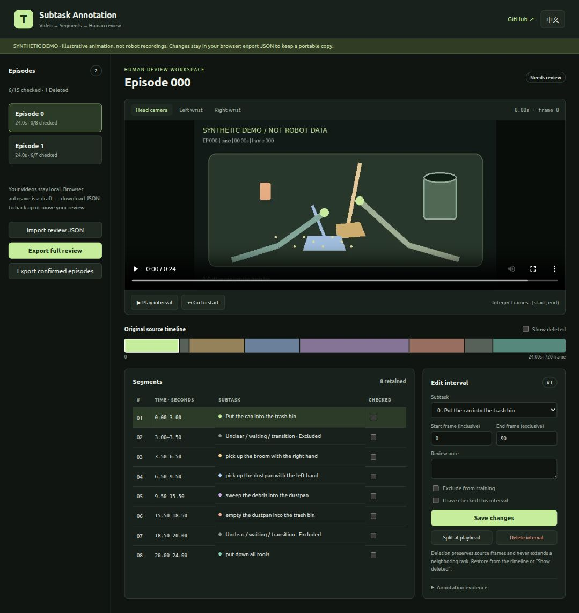

# TagData · Subtask Annotation

[简体中文](README.zh.md) · [Workflow](docs/workflow.md) · [Assistant collaboration](docs/assistant.md) · [Training integration](docs/gr00t.md)

An interactive video workbench for segmenting robot demonstrations into human-reviewed, frame-accurate subtasks. Start from model-generated candidates or unlabeled recordings. The centerpiece is the **web reviewer**: watch the recording, inspect each boundary, split or relabel intervals, mark unclear activity, delete unwanted intervals, and export a portable review.

**[Open the interactive demo](https://hopper617.github.io/TagData/)**



```text
DINO candidates → assistant visual inspection → interactive human review
               → sparse annotations + expert-only action-window masks
```

The live demo contains **two synthetic episodes with three camera views**. It contains no robot recordings, state/action data or model weights. All edits stay in your browser; export JSON to keep a portable copy.

## Try the workbench

Python 3.10+ is sufficient. No npm install, model download or GPU is needed.

```bash
git clone https://github.com/Hopper617/TagData.git
cd TagData
python3 tools/serve.py --port 8765
```

Open **http://127.0.0.1:8765/**. Use HTTP rather than opening `index.html` directly: browser modules and video seeking need it. Switch between English and Chinese from the header.

The workbench includes:

- Episode progress, head/left-wrist/right-wrist video views and interval playback.
- A timeline in original source coordinates, an interval table and an editor for task ID, integer boundaries, notes and confirmation.
- Splitting at the playhead and explicit `-1` labels for unclear purpose, waiting or transitions.
- Reversible deletion: deleted time stays visible on the timeline and **never becomes part of a neighboring task**.
- Browser autosave, full-review JSON export/import with explicit draft-conflict resolution, and confirmed-episode JSONL export.
- Evidence links, annotation reasons and boundary uncertainty when supplied by the annotation source.

## Review your own recordings

The local builder supports the LeRobot v2 layout with `meta/info.json`, `meta/episodes.jsonl` and per-episode MP4 files. Keep your **complete global task map**, even when an episode contains only a subset of tasks. See [the example map](docs/subtask_map.example.json).

```bash
python3 tools/build_review.py \
  --dataset /path/to/lerobot-dataset \
  --subtask-map /path/to/subtask_map.json \
  --annotations /path/to/candidates-or-review.json \
  --output-dir reports/my-review

python3 tools/serve.py \
  --directory reports/my-review \
  --video-root /path/to/lerobot-dataset/videos \
  --port 8765
```

Without `--annotations`, existing full-coverage `sub_tasks` are used; an unlabeled episode starts as one unknown interval. A previous v3 review preserves confirmation and deletion state. The builder creates local video symlinks and leaves the dataset untouched. It refuses to overwrite existing report directories. For screenshots referenced by candidates, use `--evidence-root` if they are outside the annotation file's directory.

The server binds to loopback, streams MP4 byte ranges, and permits external MP4 symlinks only under the specified video root. It provides no upload/write API. Real recordings are reviewed locally; the Pages demo hosts only synthetic assets.

## Continue the pipeline

Install optional data-tool dependencies in your own environment:

```bash
python3 -m venv .venv
. .venv/bin/activate
python -m pip install -r requirements.txt
```

[Workflow](docs/workflow.md) covers DINO candidates, three-view contact sheets and assistant collaboration. [Data format](docs/format.md) defines the review JSON. [Training integration](docs/gr00t.md) gives a worked example of packaging labels and consuming masks. The [12-episode case study](docs/case-study.md) documents the original workflow and verified aggregate counts.

Review exports are **annotations, not a ready-to-train dataset**. A training consumer must honor sparse boundaries, exclusions and the entire action horizon. DAgger action supervision uses `intervention.valid AND intervention.mode in {2,3}`. The included reference adapter needs integration into your dataset loader and sampler; follow the training guide for a concrete example.

## Checks and deployment

```bash
npm test                                  # Node 20+, no npm dependencies
python -m unittest discover -s tests -p 'test_*.py' -v
```

[Validation notes](docs/validation.md) distinguish automated checks from outstanding real-browser checks. To regenerate the synthetic videos, install Pillow and FFmpeg, then run `python tools/make_demo.py`.

For Pages: select **Settings → Pages → Source → GitHub Actions** and run the bundled “Deploy demo” workflow. It publishes only `web/`. Keep local reports under the ignored `reports/` directory and inspect staged files before pushing.

Apache-2.0. See [LICENSE](LICENSE) and [NOTICE](NOTICE) for attribution.
