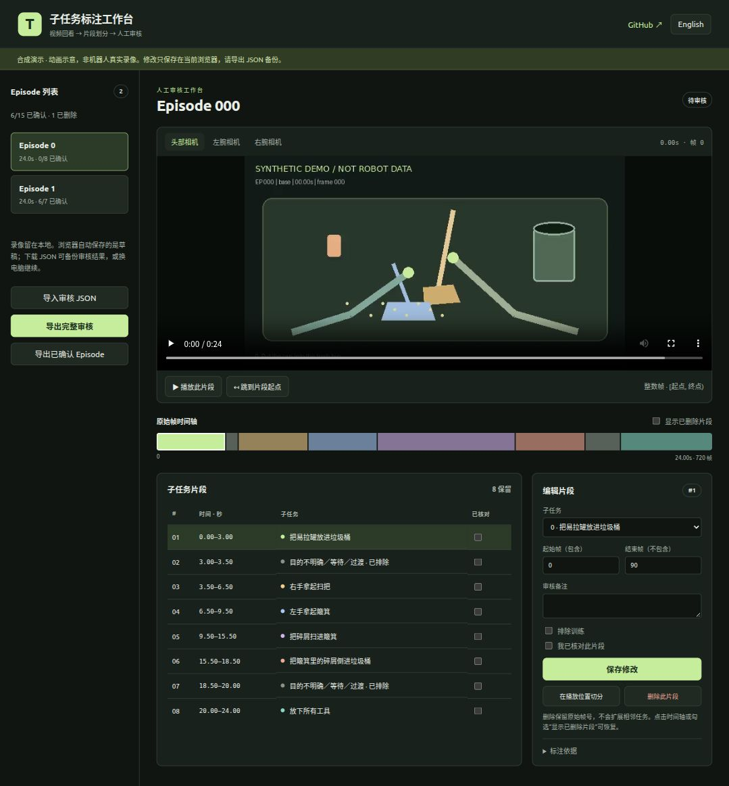

# TagData · 子任务标注工作台

[English](README.md) · [完整流程](docs/workflow.zh.md) · [助手协作](docs/assistant.md) · [训练接入示例](docs/gr00t.zh.md)

用于回看机器人示教录像、划分子任务并逐段人工审核的交互式标注工具，支持从模型候选标注或未标注录像开始。核心是**可运行的交互网页**：观看录像、核对任务边界、切分或修改片段、标记没有明确目的的活动、删除不需要的片段，再导出完整审核结果。

**[打开在线标注工作台](https://hopper617.github.io/TagData/)**



```text
DINO 预标注 → 助手查看录像与调整 → 网页逐段人工审核
           → 稀疏子任务标注 + 仅专家动作的采样掩码
```

在线 Demo 包含 **2 条合成 Episode、每条 3 路相机录像**，不包含真实机器人录像、状态、动作或模型权重。修改保存在当前浏览器，可导出 JSON 备份或换电脑续审。

## 打开网页

只需要 Python 3.10+，无需安装 npm 依赖、下载模型或使用 GPU。

```bash
git clone https://github.com/Hopper617/TagData.git
cd TagData
python3 tools/serve.py --port 8765
```

访问 **http://127.0.0.1:8765/**，顶部可切换中文／英文。请使用 HTTP 服务，不要直接双击 `index.html`；浏览器模块和视频跳转需要通过服务加载。

网页保留了实际审核中使用的交互：

- Episode 切换与审核进度，头部／左腕／右腕视频切换，以及选中片段播放。
- 原始帧时间轴、片段列表，以及任务 ID、起止帧、备注和确认状态编辑。
- 在播放位置切分片段；把目的不明确、等待、过渡活动标为 `-1`。
- 删除和恢复片段：删除时间仍占据原始时间轴位置，**不会并入相邻任务**。
- 浏览器自动保存、完整 JSON 导出与导入续审；导入与已有草稿冲突时明确选择来源。
- 仅导出完成全部确认的 Episode；展示标注理由、截图链接和边界不确定范围。

## 审核自己的数据

支持包含 `meta/info.json`、`meta/episodes.jsonl` 和逐 Episode MP4 的 LeRobot v2 数据布局。请保留完整的全局子任务映射；某条 Episode 只有部分任务时，不重新编号。映射格式见[示例](docs/subtask_map.example.json)。

```bash
python3 tools/build_review.py \
  --dataset /path/to/lerobot-dataset \
  --subtask-map /path/to/subtask_map.json \
  --annotations /path/to/candidates-or-review.json \
  --output-dir reports/my-review

python3 tools/serve.py \
  --directory reports/my-review \
  --video-root /path/to/lerobot-dataset/videos \
  --port 8765
```

不提供 `--annotations` 时，使用原有完整覆盖的 `sub_tasks`；未标注 Episode 以一个未知片段开始。已有 v3 审核文件会保留确认和删除状态。生成器建立本地视频软链接，不修改原始数据，也不覆盖已有报告目录。候选标注引用的截图不在标注文件目录下时，可指定 `--evidence-root`。

本地服务只监听回环地址，支持 MP4 Range 请求以实现视频跳转，仅允许访问指定视频目录下的外部 MP4 软链接。没有上传和写入接口。真实数据留在本地，在线 Demo 只使用合成素材。

## 后续流程

数据整理和截图脚本需要可选依赖，建议在独立环境安装：

```bash
python3 -m venv .venv
. .venv/bin/activate
python -m pip install -r requirements.txt
```

[完整流程](docs/workflow.zh.md)介绍 DINO、三视角截图和助手协作；[数据格式](docs/format.md)解释审核文件；[训练接入示例](docs/gr00t.zh.md)演示生成训练包和接入采样器。[12 条数据案例](docs/case-study.md)保留了实际流程及核对后的汇总数字。

网页导出的文件是**标注结果，还不是可直接训练的数据集**。训练端需要处理稀疏边界、排除区间和完整动作窗口。DAgger 动作监督仅使用 `intervention.valid AND intervention.mode in {2,3}`。仓库提供最小参考适配代码，需要接入自己的数据加载器和采样器，具体用法见训练接入示例。

## 验证与上线

```bash
npm test                                  # Node 20+，不需要安装 npm 依赖
python -m unittest discover -s tests -p 'test_*.py' -v
```

[验证记录](docs/validation.md)区分了自动化测试与尚待完成的浏览器验收。安装 Pillow 和 FFmpeg 后，可运行 `python tools/make_demo.py` 重新生成合成视频。

GitHub Pages 部署：在 **Settings → Pages → Source** 选择 **GitHub Actions**，运行仓库内的 “Deploy demo” 工作流。只发布 `web/` 目录。真实审核报告放在已忽略的 `reports/` 目录，推送前检查暂存文件。

采用 Apache-2.0，署名信息见 [LICENSE](LICENSE) 和 [NOTICE](NOTICE)。
